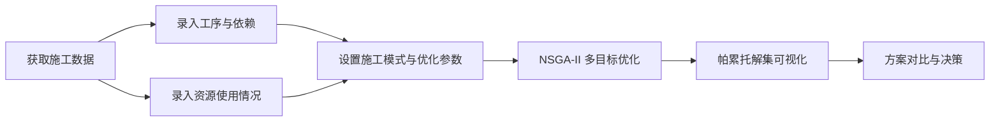

# 软件简介

## 这个软件解决什么问题？

一个工程项目由若干**工序**（如"基础开挖""主体结构施工""屋面防水"）组成。施工过程中，每个工序会产生**成本**（人工、机械、材料费用）、消耗**时间**（工期），并产生**碳排放**。

施工方在组织施工时，可以针对每个工序选择不同的**施工策略**，例如：

- **加速施工**：加班加点、增加机械，缩短工期但提高成本；
- **低碳施工**：升级环保机械，降低碳排放但增加机械成本。

问题在于：工序数量多、每个工序的策略选择多，**所有工序策略组合起来的方案数量是各工序可选模式数的乘积**——人工枚举完全不现实。而且"成本低、工期短、碳排放少"三个目标往往互相冲突：想压缩工期就要加钱，想降碳也要加钱。

**CCT（Construction Carbon / Cost / Time）软件的目标**：自动搜索所有可能的施工方案组合，用 **NSGA-II 多目标优化算法**找出其中的**帕累托最优解集**，帮助决策者直观看到"成本、工期、碳排放"三者之间的权衡关系，并从中选择最合适的施工方案。

## 软件的工作流程

### 1. 获取施工数据

数据来源有两种：

- **施工日报导入**：上传现场 Excel 施工日报，系统自动解析出当天各资源的用量（人员、机械、运输等），经人工核对修正后分配到具体工序；
- **手动录入**：在"资源使用录入"页面按日期、工序逐条录入资源使用量。

### 2. 建立模型

- **工序（任务）**：定义工序名称、代号、预计工期、完成度，以及工序之间的**前置依赖关系**（如"浇筑混凝土"必须等"钢筋绑扎"完成）；
- **资源**：定义资源名称、类别（人工 / 机械 / 材料 / 运输 / 其他）、单价、**碳排放因子**（每单位用量产生的碳排放量）。

### 3. 多目标优化

配置 NSGA-II 参数后启动优化。算法为每个工序从四种**施工模式**（标准 / 加速 / 低碳 / 加速低碳）中选择一种，并决定工序的开始时间偏移，在满足工序依赖关系和资源日用量上限的前提下，同时优化三个目标：

- **成本**（按月度折现后的现值）
- **总工期**（关键路径法计算）
- **总碳排放**

### 4. 结果可视化与决策

优化结束后，前端展示**帕累托前沿三维图**（成本 × 工期 × 碳排放），以及解集表格。你可以：

- 勾选多个方案进行**对比**（雷达图 + 指标对比）；
- 查看某个方案的**施工模式组合**与**甘特图**；
- 对多个优化运行的结果进行**合并**，得到更完整的非支配前沿。

## 软件特点

| 特点         | 说明                                                     |
| ------------ | -------------------------------------------------------- |
| 多项目支持   | 一个软件可同时管理多个工程项目，数据完全隔离             |
| 四种施工模式 | 标准、加速、低碳、加速低碳，模式影响成本 / 工期 / 碳排放 |
| 资源约束     | 可设置资源日用量上限，优化时自动剔除超限方案             |
| 材料周转     | 可复用材料按周转次数折减碳排放与成本                     |
| 碳排放拆解   | 标签系统 + 自定义图表，从任意维度分析碳排放构成          |
| 时间成本     | 成本按月结算并按年利率折现，考虑资金时间价值             |

## 适用场景

- 施工方案比选：在多个可行方案中寻找成本、工期、碳排的平衡点；
- 政策响应：政府或业主对施工碳排放有要求时，量化不同低碳策略的代价；
- 投标与策划：在投标阶段估算不同施工组织方式的成本与工期风险。
